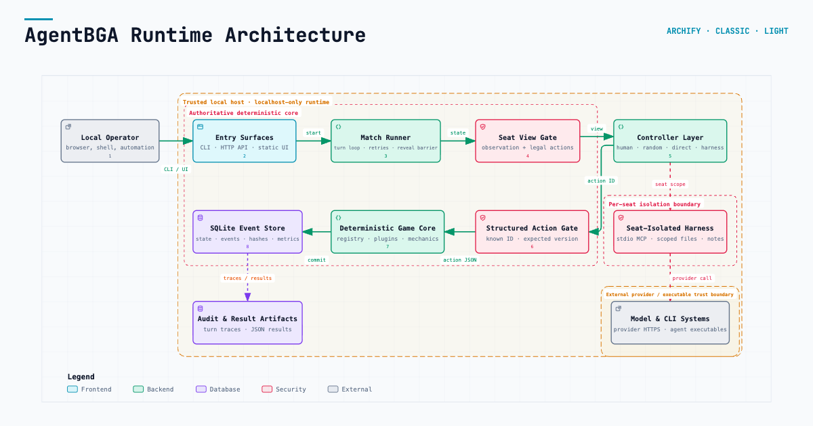

# AgentBGA

A headless, deterministic board-game environment for evaluating LLM agents in long-horizon adversarial decision-making. Supports agent-vs-agent and human-vs-agent play across multiple Euro-style strategy games.

## Runtime architecture



## Games

- **Splendor** (2–4 players, fully playable)
- **Wingspan / 展翅翱翔** (2–5 players, 170 base birds, 26 bonus cards, both goal boards; playable beta)
- **Harmonies / 自然和弦** (1–4 players, A/B boards, 32 animal cards, optional Nature’s Spirits; playable beta)
- **Azul** (2–4 players, colored-wall base game, playable beta)
- **Brass: Birmingham** (2–4 players, playable beta)
- **The Castles of Burgundy** (2–4 players, 2019 base game, playable beta)
- **Century: Spice Road** (2–5 players, fully playable)
- **Ark Nova** (1–4 players, released base-game Map 0 semantic rules plus an opt-in Map A preview; mechanics-only card data)
- **7 Wonders** (3–7 players, complete Second Edition base rules, Day/Night Wonders)
- **Carcassonne / 卡卡颂** (2–5 players, 72 base tiles with farmers; playable beta)

## Quick start

Python 3.11+, no install required:

```console
./agentbga run --players 2 --controllers random,random --seed 42
```

LLM vs random:

```console
export OPENAI_API_KEY='...'
./agentbga run --players 2 --controllers openai,random \
  --base-url https://api.openai.com/v1 --model YOUR_MODEL --seed 42 --jsonl
```

Multi-model matches via JSON config:

```console
./agentbga run --players-config examples/multi-llm-match.json --seed 42 --jsonl
```

Local live web table (Node.js 22.13+):

```console
cd web && npm ci && npm run build && cd ..
./agentbga web   # http://127.0.0.1:8765
```

Choose Ark Nova and the solo human preset to play without an API key or external
agent CLI. For multiplayer, choose human or random controllers for key-free play;
LLM controllers require their provider credentials or CLI authentication.

The setup page lists recent SQLite matches, including tables created by
`agentbga run` or `agentbga match create`. Click one, or open
`http://127.0.0.1:8765/?match=MATCH_ID`, to spectate without taking over the
runners. Pause still applies only to matches started from the web form.

### Harmonies / 自然和弦

```console
./agentbga run --game harmonies --players 2 --controllers random,random --seed 42
./agentbga run --game harmonies --players 1 --controllers random --seed 42 \
  --game-config '{"board_side":"B","nature_spirits":true}'
```

In the Web setup choose **自然和弦 / Harmonies**, select A (river) or B (islands),
and optionally enable Nature's Spirits. The **Solo** preset needs no API key.
Take a token group, select a token and click a highlighted hex. Animal cards show
exact stack heights and mark the cube target; click **Settle animal** and a
highlighted target when available. Optional card/animal actions can interrupt
placements. Click **End turn** after all three tokens are placed.

Includes deterministic replay, cumulative animal scores, the equal-turn final
round, solo market refresh and sun ratings. Cards use stable numbers and original
SVG diagrams; the mechanical catalog is community-transcribed and the game is
labelled playable beta. No publisher art or expansion cards are bundled. See the
[implementation and validation plan](docs/harmonies-implementation-plan.md).

### Wingspan / 展翅翱翔

```console
./agentbga run --game wingspan --players 2 --controllers random,random --seed 42
./agentbga run --game wingspan --players 5 --controllers random,random,random,random,random \
  --seed 42 --game-config '{"goal_board":"blue"}'
```

In Web setup choose **展翅翱翔 / Wingspan**, 2–5 human/random/model seats,
and green (competitive) or blue (individual) round goals. Select starting birds,
discard one food per kept bird, and keep one bonus card. Click habitat actions or
play a bird from your hand, then select payments and effect choices as prompted.
Bird powers and bonus conditions have Chinese and English descriptions. Name-based
bonuses use the English bird names printed in this catalog.

Includes all 170 original base birds, 26 bonus cards, eight double-sided goal tiles,
white/brown/pink powers, exact seeded replay and hidden-information observations.
No Swift-Start birds, expansions, Automa solo mode, or publisher artwork. The
community-transcribed mechanical catalog is labelled playable beta; see
[implementation and validation](docs/wingspan-implementation-plan.md) and
[third-party notices](THIRD_PARTY_NOTICES.md).

### Carcassonne / 卡卡颂

```console
./agentbga run --game carcassonne --players 2 --controllers random,random --seed 42
./agentbga run --game carcassonne --players-config examples/carcassonne-random-match.json --seed 42
```

In Web setup choose **卡卡颂 / Carcassonne** and 2–5 human/random/model seats.
Rotate the drawn tile, click a highlighted space, then place one follower or skip.
Click any tile to inspect its connected features; scroll or zoom the shared board.
Includes all 72 base tiles, roads, cities, shields, monasteries, farmers, majority
ties, final scoring, and deterministic persisted replay. Future draw order stays
hidden. Uses original SVG graphics; excludes River, Abbot, and other expansions.
See [rules, protocol, and validation](docs/carcassonne.md).

## Harness backends

Each seat can use one of:

| Backend | Type | Notes |
|---|---|---|
| `openai` | Direct API | OpenAI-compatible chat completions |
| `anthropic` | Direct API | Anthropic Messages API |
| `gemini` | Direct API | Google Gemini generateContent |
| `opencode` | Harness | CLI + MCP, persistent session |
| `codex` | Harness | CLI + MCP, persistent session; API key or ChatGPT subscription auth |
| `dsh` | Harness | DeepSeek Harness, cold-start resumable headless profile |
| `hermes` | Harness | Hermes Agent + MCP, isolated home, persistent session |
| `claude` | Harness | Claude Code + MCP, persistent session |
| `pi` | Harness | Pi + native TS extension, persistent session |
| `qwen` | Harness | Qwen Code + MCP, isolated provider config, persistent session |
| `cursor` | Harness | Cursor Agent CLI + MCP, isolated data directory, persistent session |
| `grok` | Harness | xAI Grok Build CLI + MCP, isolated home and sandbox, persistent session; API key or SuperGrok subscription |
| `minimal` | Harness | Pure Python, in-process, direct LLM + 10 seat-scoped tools |
| `human` | — | Browser-based play |
| `random` | — | Random baseline |

All harness seats share a unified seat-scoped interface: `observe`, paged `legal_actions`,
`inspect_card`, `inspect_rules`, `inspect_map`, `inspect_played_cards`, `inspect_history`, `submit_action`,
`read_notes`, and `write_notes`. Ark Nova uses a compact default observation plus
state deltas; complete visible card, map, played-card, and observed-history details are
loaded only when requested. The `minimal` harness runs entirely in Python with zero
external dependencies — no CLI, no MCP server, no Node.js.

For game-specific legal-action filters and bounded responses, see
[Legal action queries](docs/legal-action-queries.md).

The `hermes` backend requires the `hermes` executable with MCP support. AgentBGA creates a seat-local `HERMES_HOME`, configures only the seat-scoped `agentbga` MCP server, and routes the configured OpenAI-compatible endpoint through Hermes' custom provider.

The `qwen` backend requires the `qwen` executable. AgentBGA creates seat-local
`QWEN_HOME` and `QWEN_RUNTIME_DIR` directories, configures an OpenAI-compatible
model provider, disables ambient tools and memory, and exposes only the seat-scoped
`agentbga` MCP tools. For Alibaba Cloud Coding Plan:

```console
export BAILIAN_CODING_PLAN_API_KEY='...'
./agentbga doctor --players-config examples/qwen-code-vs-random.json
./agentbga run --players-config examples/qwen-code-vs-random.json --seed 42 --jsonl
```

The `cursor` backend requires the `cursor-agent` executable and a `CURSOR_API_KEY`.
The `grok` backend requires the xAI `grok` executable and, by default, an `XAI_API_KEY`. Both
run headlessly with persistent native sessions, disable built-in coding and web
tools, and expose only AgentBGA's seat-scoped MCP tools. Their user configuration,
credentials, and sessions remain isolated per participant workspace.

```console
export CURSOR_API_KEY='...'
export XAI_API_KEY='...'
./agentbga doctor --players-config examples/cursor-cli-vs-grok-build.json
./agentbga run --players-config examples/cursor-cli-vs-grok-build.json --seed 42 --jsonl
```

Codex can reuse the ChatGPT subscription already authenticated by the local CLI. Log in
once, select `auth_mode: "subscription"`, and omit `base_url` and `api_key_env`:

```console
codex login
./agentbga doctor --players-config examples/codex-subscription-vs-random.json
./agentbga run --players-config examples/codex-subscription-vs-random.json --seed 42 --jsonl
```

Subscription mode bridges only the active Codex credential into a seat-isolated
`CODEX_HOME`, forces ChatGPT login, and disables personal plugins, skills, shell access,
history, and memories. It does not inject `OPENAI_API_KEY` or endpoint overrides. The
default `api_key` mode keeps the existing seat-isolated usage-based API configuration.

### Grok Build with a SuperGrok subscription

This extends the Grok Build backend introduced in [PR #39](https://github.com/fengrui-z/AgentBGA/pull/39).
Existing API-key configurations and the Cursor backend are unchanged. To opt into
subscription auth, install the [official CLI](https://docs.x.ai/build/overview), then:

```console
grok login
grok models
./agentbga doctor --players-config examples/grok-subscription-vs-random.json
./agentbga run --game azul --players-config examples/grok-subscription-vs-random.json --seed 42 --jsonl
```

Select **Grok Build → SuperGrok subscription** in the Web UI. This mode does not
send an API key or endpoint. JSON configurations must explicitly set
`auth_mode: "subscription"`; omitting it preserves the existing API-key behavior.
The subscription model defaults to `grok-4.6`, with the model's native reasoning
default. A JSON config can request a supported `reasoning_effort` explicitly.

Subscription mode keeps a seat-local `GROK_HOME` and the existing strict tool
sandbox. It uses the official `GROK_AUTH_PATH` override for the original login,
so Grok manages token refresh and locking without copying credentials.
`GROK_DISABLE_API_KEY_AUTH=1` prevents fallback to metered API authentication.
Personal plugins are disabled by name after read-only discovery; skill injection
and ambient compatibility integrations are disabled. Git bounds upward project
discovery to the generated seat workspace. All current seat MCP tools remain
available, including the inspection tools used by Ark Nova.

Configuration/MCP discovery was checked with Grok Build 1.0.30. `doctor` checks
the executable and local credential file, not live entitlement; subscription
limits and model availability still depend on the account. Offline tests do not
consume model quota. Missing usage/cost must not be treated as zero.

Every harness backend assigns match memory to `(match_id, seat)`. In a learning series,
memory is instead assigned to `(series_id, participant_id)`, so a competitor keeps its
own session while seats rotate and can never inherit an opponent's private context. DSh
uses a cold-start resumable runner; the other harnesses restore their native session from
the same participant workspace. Experiment runs add an internal `run_id` namespace, so
rerunning the same manifest starts with clean memory. Series execution does not add a
post-match review turn.

```json
{"backend":"dsh","model":"deepseek-v4-flash","series_id":"anneal-20","participant_id":"learner"}
```

Example harness match:

```console
export DEEPSEEK_API_KEY=...
./agentbga run --players-config examples/dsh-vs-opencode.json --seed 42 --jsonl
```

## Trace & audit

Every harness turn is saved as a structured JSON trace:

```console
./agentbga match traces MATCH_ID --json          # list all traces
./agentbga match traces MATCH_ID --seat 0 --turn 7  # export one turn
./agentbga match harness-events MATCH_ID --json      # tool call audit trail
```

Ark Nova defaults to the released Map 0 board. Pass `--map map-a` to
`match create` or `match run` to exercise the separately labelled Map A preview.

Trace files live under `.agentbga/runs/_traces/MATCH_ID/seat-N/turn-XXXX.json` and record the full decision sequence: prompt, assistant reasoning/content, tool calls with results, and the final submission. Traces also record the participant, stable session scope, resume count, and any DSh compaction events.

## Experiments and result artifacts

An experiment manifest schedules one of three reproducible evaluation modes:

- `duel`: two competitors, paired seeds, and both seat orders; no cross-match memory.
- `tournament`: every configured 2-, 3-, or 4-player combination, with every cyclic
  seat rotation; no cross-match memory.
- `series`: a two-player sequence with alternating seats. One or both competitors may
  retain memory across the series; independent replicates never share memory. Replicate
  starting seats alternate for odd-length series, and generated replicate seeds occupy
  disjoint ranges while each result retains its original `base_seed`.

```console
./agentbga experiment validate --config examples/experiment-duel.json
./agentbga experiment run --config examples/experiment-duel.json \
  --out .agentbga/experiments/duel-001
```

Runnable examples are provided in
[`examples/experiment-duel.json`](examples/experiment-duel.json),
[`examples/experiment-tournament.json`](examples/experiment-tournament.json), and
[`examples/experiment-series-one-sided.json`](examples/experiment-series-one-sided.json).

The server-resumable 12-participant, 396-match balanced frontier tournament is
configured in [`examples/frontier12-tournament.json`](examples/frontier12-tournament.json).
See [`docs/frontier12-server-run.zh-CN.md`](docs/frontier12-server-run.zh-CN.md) for
credential checks, the four-match all-participant probe, 16-worker execution, and recovery.

Every run writes cumulative `agentbga.results.v1` documents atomically. `latest.json`
is refreshed after every configured batch, `results-000020.json` is an immutable
checkpoint, and `final.json` is the complete artifact. Set `results.emit_every` to `1`
for every match or to `N` for every N matches. The format is defined by
[`schemas/results-v1.schema.json`](schemas/results-v1.schema.json).

Each completed match result also includes `harness_metrics`. For every harness seat it
records provider-reported input and output tokens, cache reads and writes, uncached input,
reasoning tokens, cache-hit rate, controller calls, failures and random fallbacks, session
resumes, compactions, and process/action latency statistics. Match-level totals use
`cached_input_tokens / input_tokens` for the cache-hit rate; reasoning tokens are a subset
of output tokens and are not counted twice. If a harness or provider does not expose exact
usage, its `token_usage.available` is `false` and `totals.complete` is `false` rather than
substituting an estimate.

Trusted upload credentials may be embedded at generation time without putting the token
in the experiment manifest:

```json
{"results":{"emit_every":20,"submission_token_env":"AGENTBGA_RESULTS_TOKEN"}}
```

The resulting file contains `submission.token`; its integrity digest deliberately covers
only the benchmark data, not the transport credential. A receiving service must validate
and discard the token before storing the artifact.

## CLI

```console
agentbga games list --json
agentbga match create --game splendor --players 4 --seed 42 --json
agentbga match create --game azul --players 2 --seed 42 --json
agentbga match create --game castles_of_burgundy --players 2 --seed 42 --json
agentbga match create --game seven_wonders --players 3 --seed 42 --json
agentbga match observe MATCH_ID --seat 0 --json
agentbga match legal-actions MATCH_ID --seat 0 --json
agentbga match act MATCH_ID --seat 0 --expected-version 7 \
  --action '{"type":"take_tokens","colors":["white","blue","green"]}' --json
agentbga match events MATCH_ID --jsonl
agentbga match verify MATCH_ID --json
agentbga match replay MATCH_ID --json
agentbga match traces MATCH_ID --json
agentbga experiment validate --config EXPERIMENT.json
agentbga experiment run --config EXPERIMENT.json --out RESULTS_DIR
agentbga web --port 8765
```

## Principles

- Deterministic, seeded game engines with exact replay and state verification.
- Strict per-seat observations — hidden information cannot leak.
- Simultaneous-choice games use frozen observations, parallel agent calls, and a reveal barrier.
- Event-sourced matches with SQLite persistence.
- API keys are never written to disk, events, or logs.
- Reproducible evaluation across models, harnesses, seeds, and seat order.

## Design

See [docs/architecture.md](docs/architecture.md) for architecture notes and [docs/project-overview.zh-CN.md](docs/project-overview.zh-CN.md) for a Chinese overview.

Ark Nova follows the [English Rulebook v1.2](https://www.feuerland-spiele.de/fileadmin/game/Arche_Nova/Arche_Nova_Rules_EN_Low_2022_01.pdf). Azul implements the colored-wall base game with deterministic physical tiles. No scanned card art or publisher rules text is bundled.
