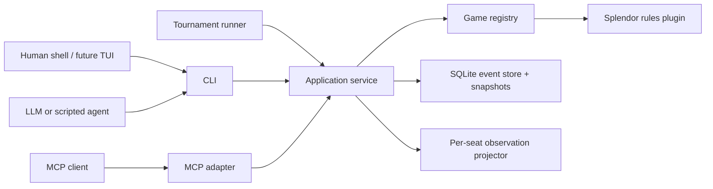

# AgentBGA Architecture Proposal

## 1. Goal and non-goals

AgentBGA should answer a research question: how well can an LLM retain goals,
adapt plans, and make legal, strategically coherent decisions across long,
multiplayer board-game trajectories?

The framework must support:

- agent-vs-agent, agent-vs-human, and human-vs-human matches;
- local model processes, hosted model APIs, scripted baselines, and MCP clients;
- deterministic experiment reproduction and full audit trails;
- games with public and private information;
- batch tournaments with model-cost and decision-quality measurements.

The initial release is not a graphical clone of Board Game Arena, a rules tutor,
or a general-purpose chat framework. It is a research-grade headless environment.
The name refers to the arena concept; it should not depend on or impersonate the
Board Game Arena service.

## 2. Architectural decisions

### 2.1 One authoritative application service

The CLI, MCP server, interactive shell, and tournament runner all call the same
application service. None of these surfaces may implement game rules themselves.
This prevents behavioral differences between human and agent play.



### 2.2 Pure deterministic rules core

Each game plugin implements a deterministic transition function:

```text
transition(state, action, actor, rng_state) -> (new_state, domain_events)
```

Random setup is driven by an explicit seed. The core has no filesystem, network,
clock, model, or UI dependency. Given the same game version, seed, and actions,
the event log and terminal result must be byte-for-byte reproducible.

### 2.3 Event sourcing plus snapshots

The authoritative record is an append-only stream containing match creation,
random setup results, accepted actions, derived game events, and terminal results.
Snapshots are performance caches and can always be rebuilt. Each event records:

- `match_id`, monotonic `seq`, and `state_version`;
- rules package and schema versions;
- actor/seat and public/private visibility;
- canonical payload;
- previous and resulting state hashes;
- timestamp for operations, but never as a rules input.

This enables replay, debugging, dataset export, abandoned-match recovery, and
post-hoc evaluation without relying on model prose.

### 2.4 Observation is not state

The internal state may contain all hidden information. Agents only receive a
projection produced for their seat. Observations have three visibility classes:

- `public`: visible to every participant;
- `private`: visible only to one seat (for example a face-down reserved card);
- `admin`: seeds, deck order, and complete state, available only to trusted tools.

Tests must assert that private values never occur in another seat's serialized
observation, events, error messages, or legal-action descriptions.

### 2.5 Structured actions only

Free-form text is never interpreted by the rules engine. An action is a typed JSON
object validated against the game's versioned schema. Natural-language agents may
reason in prose, but must finish by selecting a legal action ID or submitting a
structured action.

Every observation includes `state_version`. Mutations require
`expected_version`; stale actions fail atomically. This matters when humans,
agents, watchers, and tournament processes operate concurrently.

## 3. Suggested package layout

Python 3.12 is recommended for research velocity, model ecosystem support, and
property-based testing. Use `uv`, `pydantic` at protocol boundaries, immutable
dataclasses in the rules core, `Typer` for commands, SQLite for local persistence,
and the official MCP Python SDK for the adapter.

```text
agentbga/
  core/
    models.py          # IDs, seats, events, results, protocol versions
    engine.py          # generic game protocol and transition contracts
    observations.py    # visibility and redaction primitives
    errors.py          # stable machine-readable error taxonomy
  games/
    splendor/
      manifest.py
      models.py
      setup.py
      rules.py
      legal_actions.py
      observations.py
      scoring.py
      schemas/
  app/
    matches.py         # transactions and use cases
    registry.py        # game discovery/version pinning
    replay.py
  storage/
    sqlite.py
    migrations/
  cli/
    main.py
    render.py          # JSON/JSONL and human-readable presentation
  mcp/
    server.py          # thin mapping onto app services
  agents/
    protocol.py
    subprocess.py
    scripted/
  arena/
    runner.py
    scheduling.py
    metrics.py
    export.py
tests/
  core/
  games/splendor/
  protocol/
  replay/
docs/
```

Do not create a generic abstraction for every board-game concept. The plugin
boundary should initially require only setup, transition, legal-action generation,
observation projection, terminal detection, scoring, and schema/metadata. Extract
shared concepts only after the second game exposes genuine commonality.

## 4. Game plugin contract

A game package implements the following logical interface:

```python
class Game(Protocol):
    manifest: GameManifest

    def setup(self, config: JsonObject, seed: int) -> GameState: ...
    def legal_actions(self, state: GameState, seat: int) -> list[Action]: ...
    def transition(self, state: GameState, seat: int, action: Action) -> Transition: ...
    def observe(self, state: GameState, viewer: Viewer) -> Observation: ...
    def status(self, state: GameState) -> GameStatus: ...
    def score(self, state: GameState) -> list[PlayerResult]: ...
    def invariants(self, state: GameState) -> list[InvariantViolation]: ...
```

The manifest declares stable game ID, human name, rules version, supported player
count, configuration schema, action schemas, observation schema, and capability
flags such as hidden information, simultaneous action, negotiation, and chance.
Those flags allow future runners to reject unsupported combinations explicitly.

## 5. CLI as the canonical public API

### 5.1 Output contract

- `--json` emits exactly one JSON value to stdout.
- `--jsonl` emits one complete event/result per line and is suitable for streaming.
- Logs and diagnostics go only to stderr.
- Success is exit code `0`; usage, rule rejection, conflict, unavailable turn,
  timeout, and internal failure have stable distinct exit codes.
- Machine output always contains `schema_version`.
- IDs and enums are stable strings; presentation labels are separate fields.
- Commands never prompt when `--json` or `--jsonl` is active.
- Secrets, model reasoning, and private observations are never included by default.

Example observation envelope:

```json
{
  "schema_version": "agentbga.observation.v1",
  "match_id": "01J...",
  "game": {"id": "splendor", "rules_version": "base-1.0"},
  "state_version": 7,
  "viewer": {"seat": 0},
  "turn": {"active_seat": 0, "round": 3, "phase": "main_action"},
  "observation": {},
  "legal_actions": [
    {
      "id": "a_7_016",
      "action": {
        "type": "take_tokens",
        "colors": ["white", "blue", "green"],
        "return": []
      }
    }
  ]
}
```

An action ID is valid only for one match version. The server stores or can
recompute the canonical action behind it. Accepting both `--action-id` and
`--action` makes simple tool use cheap while keeping the protocol transparent.

### 5.2 Command groups

| Group | Essential commands | Purpose |
|---|---|---|
| `games` | `list`, `describe`, `schema`, `rules` | Discovery and machine-readable contracts |
| `match` | `create`, `observe`, `legal-actions`, `act`, `status`, `events`, `watch`, `resign` | Live match lifecycle |
| `match` | `replay`, `verify`, `export`, `fork` | Research, debugging, counterfactual branches |
| `run` | config-driven match execution | Bind seat controllers and run one match |
| `arena` | `run`, `status`, `report`, `export` | Repeated experiments and tournaments |
| `agent` | `list`, `check`, `run` | Validate and invoke controller adapters |
| `mcp` | `serve` | Expose the same operations over stdio MCP |
| `db` | `migrate`, `doctor` | Explicit local administration |

`match fork` is valuable for long-horizon research: it creates a new match from a
historical state version so multiple candidate actions can be rolled out without
mutating the original trajectory.

## 6. MCP mapping

Start with a small tool set. Large, game-specific tool inventories increase model
confusion and make experiments incomparable.

| MCP tool | Application operation |
|---|---|
| `games_list` | Discover installed games |
| `game_describe` | Fetch rules summary and JSON schemas |
| `match_create` | Create a seeded match |
| `match_observe` | Get the requesting seat's projected state and legal actions |
| `match_act` | Submit action ID or structured action with expected version |
| `match_status` | Inspect lifecycle/result without advancing play |
| `match_events` | Read visibility-filtered events incrementally |
| `match_resign` | End participation explicitly |

Rules and replay data can additionally be MCP resources such as
`agentbga://games/splendor/base-1.0/rules` and
`agentbga://matches/{id}/replay`. The MCP adapter authenticates a client to a seat;
it must not accept an arbitrary viewer seat from an untrusted caller.

The CLI remains independently complete. MCP is a transport adapter, not the only
way an agent can play.

## 7. Match and controller model

A match has immutable game/config/seed metadata, ordered seats, a lifecycle state,
and an optimistic `state_version`. A seat is bound to one controller:

- `human`: no process is launched; the runner waits for a valid external action;
- `subprocess`: JSONL messages over stdin/stdout with time and memory limits;
- `mcp-client`: an external client claims a scoped seat token;
- `model`: a provider adapter that converts an observation into a tool call;
- `scripted`: random, greedy, heuristic, search, or test controller.

The runner owns scheduling, deadlines, retries, and adjudication. The rules engine
only knows seats and actions. A model failure is never silently converted into a
game action; experiment configuration must choose one policy: retry, random legal
fallback, resign, or forfeit. The chosen policy is recorded in the event log.

For human play, `match watch --seat N` renders updates and waits; the human submits
with `match act`. A future TUI should simply automate those same calls.

## 8. Splendor MVP

### 8.1 Rules scope

Implement the original base game for 2–4 players, with no expansions and no house
rules. Pin this as a named ruleset rather than calling it merely “latest.” Include:

- player-count-dependent gem-bank setup and five gold tokens;
- three development decks with four face-up cards per tier;
- `players + 1` visible nobles;
- take three different gem colors;
- take two of one color only when at least four of that color existed before taking;
- reserve a visible or top-deck card, maximum three reserved cards, gaining gold
  when available;
- buy a visible or reserved card using permanent bonuses, gem tokens, and gold;
- enforce the ten-token limit by making returned tokens part of the same atomic
  action;
- award at most one eligible noble at turn end, with player choice when several
  are eligible;
- trigger the final round at 15 prestige, let all players receive equal turns, and
  apply the official tie-break based on purchased development-card count.

Represent a reserve-from-deck card as private to its owner while deck counts remain
public. This exercises the visibility architecture before adding games with more
substantial hidden information.

### 8.2 Action union

```text
take_tokens(colors, return_tokens)
reserve_visible(card_id, return_tokens)
reserve_deck(tier, return_tokens)
buy_visible(card_id, payment)
buy_reserved(card_id, payment)
choose_noble(noble_id)
pass(reason="no_legal_main_action")  # generated only if no printed-rule action exists
```

Payment may be generated canonically by the engine to reduce redundant actions;
if several gold/color payment choices have strategic consequences, each distinct
legal payment remains representable. Noble choice is a separate phase so it is
never hidden inside engine tie-breaking. Token returns may be bundled into the
preceding action to keep a whole turn transaction atomic.

### 8.3 State invariants

At minimum, automatically check after every transition:

- every physical token is in exactly one valid location and totals are conserved;
- every development and noble card is in exactly one valid location;
- display widths and replenishment behavior are correct;
- no player exceeds token/reserve limits after a completed action;
- discounts, payments, bonuses, and prestige are consistent;
- only the active seat acts and phase-specific actions are enforced;
- terminal scoring and tie-break ordering are deterministic.

## 9. Long-horizon agent interface

The environment should expose facts and actions, not prescribe one prompting
strategy. A model adapter owns its context policy and may receive:

- full current observation and legal actions;
- recent visible events since its previous turn;
- compact match summary and turn/round counters;
- its own private notebook from earlier turns;
- fixed rules text and experiment-specific instructions.

Keep the private notebook outside authoritative game state but version and archive
it with experiment traces. This lets research compare stateless agents, rolling
summaries, explicit plans, reflection, and retrieval without changing game rules.

The framework should capture model request metadata, response/tool call, latency,
token counts, provider/model version, prompt-template hash, errors, and optional
encrypted raw traces. Chain-of-thought must never be required or treated as a
ground-truth metric.

## 10. Evaluation design

### 10.1 Baselines

Ship at least four non-LLM controllers:

1. random legal action;
2. greedy immediate prestige/value;
3. hand-authored heuristic with reserve and noble awareness;
4. search-based baseline where computationally practical.

Without progressively stronger baselines, a win rate against random agents says
little about long-horizon ability.

### 10.2 Metrics

Record both game outcomes and process quality:

- win, placement, prestige, tie-break, turn count, and rating (Elo/TrueSkill);
- legality failures, stale actions, timeouts, retries, and forfeits;
- tool calls, input/output tokens, wall time, and estimated cost per decision/game;
- performance by seat, player count, opponent mix, seed, and game length;
- lead conversion, plan persistence, target-card completion, reserve utility, token
  efficiency, and avoidable blocked turns;
- counterfactual action value on sampled decision points using a pinned evaluator
  or rollout policy, clearly labeled as an estimate rather than ground truth.

### 10.3 Experimental controls

- Pin engine/rules/schema, model snapshot, adapter, prompt hash, and generation
  settings in every run.
- Rotate seats and reuse paired seeds across agents.
- Run enough repetitions for confidence intervals; report raw samples as well as
  aggregate rankings.
- Separate model ability from fallback-policy wins.
- Keep a frozen benchmark set of seeds plus a hidden evaluation set.
- Store all accepted actions and visible observations needed to reproduce a run.

## 11. Persistence and concurrency

SQLite in WAL mode is sufficient for local MVP use. Use a transaction per accepted
action, a unique `(match_id, state_version)` constraint, and compare-and-swap on
`expected_version`. Suggested logical tables:

- `matches`, `seats`, `events`, `snapshots`;
- `controllers`, `model_calls`, `agent_memory`;
- `arena_runs`, `arena_matches`, `metrics`.

Large raw model payloads can move to content-addressed compressed files while the
database stores hashes and metadata. A later server deployment may replace SQLite
without changing game or CLI contracts.

## 12. Verification strategy

- Example-based unit tests for every rule edge case.
- Property tests generating legal trajectories and checking all invariants.
- Golden replay fixtures whose final state hashes must remain stable.
- Serialization/schema compatibility tests for CLI and MCP envelopes.
- Visibility tests comparing every pair of seats.
- Crash-recovery and concurrent stale-action tests.
- Seed determinism tests across fresh processes.
- End-to-end matches for every combination of supported player count and baseline.

A rules change that alters replay results requires a new `rules_version`; it must
not silently rewrite old matches.

## 13. Implementation milestones

### M0 — Contract skeleton

- Package/tooling, game protocol, IDs/errors, JSON Schemas, CLI output contract.
- In-memory match service and a tiny test game used to validate architecture.
- Decision: freeze `agentbga.protocol.v1` only after CLI golden tests pass.

### M1 — Complete Splendor engine

- Setup, legal actions, transitions, visibility, scoring, invariants.
- Seeded tests and golden full-game replays.
- Random and greedy controllers.

### M2 — Persistent playable CLI

- SQLite event store, snapshots, all essential `match` commands.
- Human-vs-human and human-vs-scripted play through separate shell processes.
- Replay, verify, export, and crash recovery.

### M3 — Agent and MCP layer

- Subprocess controller protocol and MCP stdio adapter.
- One hosted-model adapter kept outside the rules core.
- Time/token budgets, failure policies, trace capture, and seat-scoped credentials.

### M4 — Research arena

- Config-driven batch scheduling, seat rotation, paired seeds, reports, and dataset
  export.
- Heuristic/search baselines and confidence intervals.
- Long-horizon ablations: memoryless, transcript, summary, notebook, reflection.

### M5 — Validate extensibility

- Implement a second game slice before broad framework abstraction.
- Add simultaneous/hidden-information capabilities only when the selected game's
  rules require them.
- Then begin a heavier full game such as *The Castles of Burgundy* or *Ark Nova*.

## 14. Decisions to freeze early

Freeze these before building model adapters:

1. CLI JSON envelopes, error codes, and stdout/stderr rules.
2. State/action/event identity and versioning.
3. Seat-scoped observation and authentication boundaries.
4. Replay determinism and rules-version policy.
5. Whether a complex turn is one atomic action or an explicit phase sequence.

The recommended answer for Splendor is: atomic token return, explicit noble-choice
phase, explicit payment, and one accepted mutation per state version. These choices
keep the action model precise without making agents manage unnecessary UI steps.
